<picture>
  <source media="(prefers-color-scheme: dark)" srcset="assets/banner-dark.svg">
  
</picture>

<p align="center">🟢 &nbsp;founder @ <a href="https://davintek.com/"><b>davintek.com</b></a> &nbsp;·&nbsp; writing @ <a href="https://www.tungdadev.com/"><b>tungdadev.com</b></a></p>

<p align="center">
  <a href="https://www.tungdadev.com/"></a>
  <a href="https://davintek.com/"></a>
  <br>
  <a href="https://www.linkedin.com/in/TungDaDev/"></a>
  <a href="https://x.com/cris_torvalds"></a>
  <a href="https://www.facebook.com/TungDaDev"></a>
  <a href="https://t.me/TungDaDev"></a>
  <a href="mailto:bthanhtung.ite@gmail.com"></a>
</p>

```ts
const tungdadev = {
  role:        "Software Engineer | Builder | Learner | Writer",
  building:    ["financial systems", "payment platforms", "e-wallets"],
  company:     "Founder @ Davintek — davintek.com",
  location:    "Viet Nam 🇻🇳",
  sideProject: "squad-devkit — one manager agent, on-demand AI workers",
  writing:     "tungdadev.com",
  believes:    "There is nothing impossible for those who have strong will.",
  askMeAbout:  ["distributed systems", "Spring, Node & React in production", "AI coding agents"],
} as const;
```

### ⚡ Stack

<p>
  <picture>
    <source media="(prefers-color-scheme: dark)" srcset="https://skillicons.dev/icons?i=java%2Cspring%2Cnodejs%2Cnestjs%2Creact%2Cts%2Cgo%2Crust%2Cpostgres%2Cmysql%2Credis%2Ckafka%2Cdocker%2Ckubernetes%2Cgithubactions%2Clinux%2Carch&perline=17&theme=dark">
    
  </picture>
</p>

### 🛠️ Things I build

<table>
  <tr>
    <td width="50%" valign="top">
      <a href="https://github.com/bthanhtung/squad-devkit"><b>🤖 squad-devkit</b></a> &nbsp;
      <br><sub>One manager agent, on-demand workers, fewer tokens. Claude Code plans; Codex / Claude workers build in isolated git worktrees; the manager verifies and merges.</sub>
    </td>
    <td width="50%" valign="top">
      <a href="https://github.com/bthanhtung/pwd-manager"><b>🔐 pwd-manager</b></a> &nbsp;
      <br><sub>A self-hosted, team-oriented password and secret manager.</sub>
    </td>
  </tr>
  <tr>
    <td width="50%" valign="top">
      <a href="https://github.com/bthanhtung/snap-frame"><b>📸 snap-frame</b></a> &nbsp;
      <br><sub>Turns raw photos into gallery-style shots with automated EXIF frames. <a href="https://snap-frame-ebon.vercel.app">Live demo →</a></sub>
    </td>
    <td width="50%" valign="top">
      <a href="https://github.com/bthanhtung/latex-resume-builder"><b>📄 latex-resume-builder</b></a> &nbsp;
      <br><sub>Build LaTeX resumes locally: one-click PDF, auto-cleanup, no compile limits. A lightweight Overleaf alternative.</sub>
    </td>
  </tr>
</table>

### 🎈 Just for fun

<table>
  <tr>
    <td width="25%" align="center" valign="top">
      <a href="https://www.tungdadev.com/"><b>✍️ Blog</b></a>
      <br><sub>Engineering, systems &amp; life</sub>
      <br><sub><a href="https://www.tungdadev.com/">tungdadev.com →</a></sub>
    </td>
    <td width="25%" align="center" valign="top">
      <a href="https://quote.tungdadev.com/"><b>💬 Quotes Random</b></a>
      <br><sub>A random quote, one click away</sub>
      <br><sub><a href="https://quote.tungdadev.com/">live</a> · <a href="https://github.com/bthanhtung/quote-random">source</a></sub>
    </td>
    <td width="25%" align="center" valign="top">
      <a href="https://saptet.tungdadev.com/"><b>🧧 Tet Countdown</b></a>
      <br><sub>Countdown to Lunar New Year</sub>
      <br><sub><a href="https://saptet.tungdadev.com/">live</a> · <a href="https://github.com/bthanhtung/count-down">source</a></sub>
    </td>
    <td width="25%" align="center" valign="top">
      <a href="https://christmas.tungdadev.com/"><b>🎄 Merry Christmas</b></a>
      <br><sub>A little Christmas greeting page</sub>
      <br><sub><a href="https://christmas.tungdadev.com/">live</a> · <a href="https://github.com/bthanhtung/merry-christmas">source</a></sub>
    </td>
  </tr>
</table>

<!--QUOTE:START-->
<p align="center"><sub><i>“The function of good software is to make the complex appear to be simple.”</i> — Grady Booch</sub></p>
<!--QUOTE:END-->
